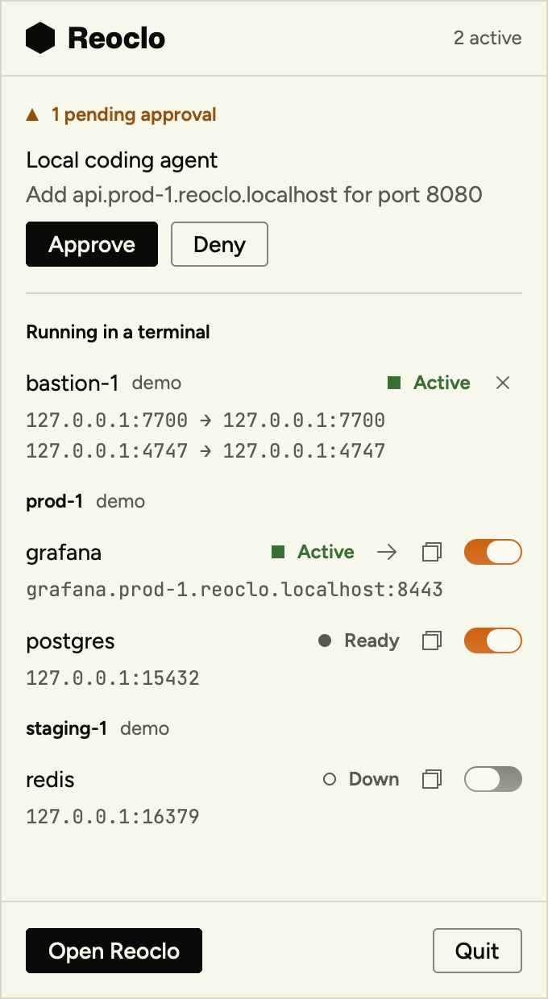
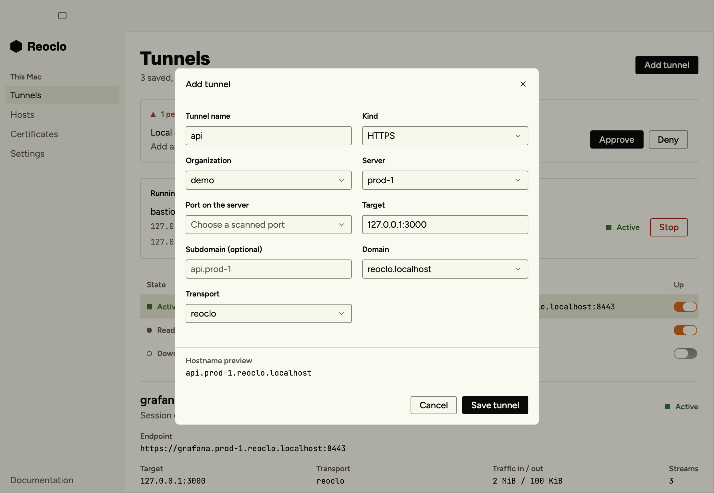
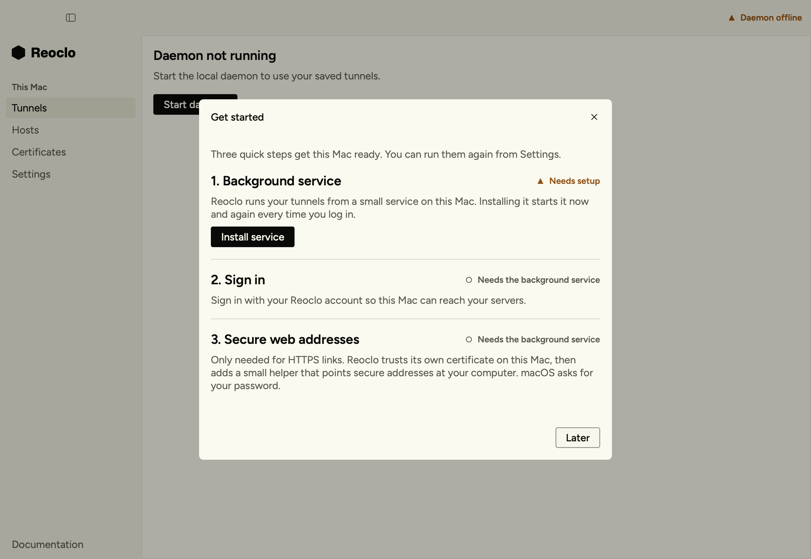

<p align="center">
  
</p>

# Reoclo for macOS

Reoclo for macOS puts your [Reoclo](https://reoclo.com) tunnels in the menu bar. Bring a saved tunnel up with one switch and open its endpoint. When a tunnel fails, the app says why and what to do next.

It is a native app written in Rust and drawn with [Rune](https://github.com/anomalyco/rune). It controls the tunnel daemon that the [Reoclo CLI](https://github.com/reoclo/cli) runs on your Mac, and it never stores your Reoclo credentials.

<picture>
  <source media="(prefers-color-scheme: dark)" srcset="docs/images/tunnels-dark.png">
  
</picture>

## What you can do

- **Reach a server's private services.** Forward a database or an internal dashboard to a port on your Mac, then connect with the tools you already use. Every saved tunnel has its own switch.
- **Open internal sites over HTTPS.** An HTTPS tunnel gets a trusted certificate and a hostname such as `https://grafana.prod-1.reoclo.localhost:8443`. Turn on the port 443 relay and the port drops out of the address.
- **Serve your own apps on HTTPS.** A local tunnel gives a service on your Mac a hostname under a domain you trust, such as `https://app.reoclo.test`.
- **Work from the menu bar.** The panel lists every tunnel by server, with its switch and buttons to open or copy the endpoint. The menu bar item can show the active count, or a meter with one bar per tunnel.
- **Keep coding agents in check.** Agents using Reoclo's MCP tools can open forward tunnels on their own. Reverse tunnels, public binds, hostname changes and tailnet shares wait for your approval in the app.
- **See tunnels started in a terminal.** A `reoclo tunnel <server> -L ...` session appears with its real ports, so you can stop it or add HTTPS for the same target.

### The menu-bar panel

<picture>
  <source media="(prefers-color-scheme: dark)" srcset="docs/images/panel-dark.png">
  
</picture>

### Adding a tunnel

Pick an organization and a server, then choose one of the ports Reoclo scanned on it or type a target. For HTTPS, the form previews the hostname before you save.

<picture>
  <source media="(prefers-color-scheme: dark)" srcset="docs/images/add-tunnel-dark.png">
  
</picture>

### Local HTTPS

Certificates manages the local certificate authority and the domains it may sign for. Hosts keeps the hostnames that point at your Mac.

<picture>
  <source media="(prefers-color-scheme: dark)" srcset="docs/images/certificates-dark.png">
  
</picture>
<picture>
  <source media="(prefers-color-scheme: dark)" srcset="docs/images/hosts-dark.png">
  
</picture>

## Requirements

You need macOS 13 or later and a [Reoclo](https://reoclo.com) account. The app drives the tunnel daemon in the Reoclo CLI, version 0.103.1 or later, so install the CLI first:

```sh
brew install reoclo/tap/reoclo
```

## Install

There is no signed download yet, so build the app from source. You need [rustup](https://rustup.rs), which installs the pinned compiler on the first build, and [uv](https://docs.astral.sh/uv/), which builds the disk image.

```sh
git clone https://github.com/reoclo/desktop.git
cd desktop
scripts/bundle-macos.sh "$(command -v reoclo)"
cp -R dist/Reoclo.app /Applications/
open /Applications/Reoclo.app
```

The app is signed ad hoc, and `dist/Reoclo.dmg` holds the same app.

On first launch, **Get started** installs the background service and signs you in. Secure web addresses are optional, and you can set them up later from Settings.

<picture>
  <source media="(prefers-color-scheme: dark)" srcset="docs/images/get-started-dark.png">
  
</picture>

## How it works

The daemon holds the tunnels, your sign-in, the certificates and the privileged helpers. The app talks to it over its Unix socket with HTTP and server-sent events, so quitting the app leaves your tunnels running.

Actions that change the system, such as installing the background service or the hosts helper, run the Reoclo CLI already on your Mac. That way `brew upgrade reoclo` reaches the daemon. Unless `REOCLO_CLI` names one, the app uses the CLI the daemon reports, then the one in the daemon's launch agent, then the standard install folders, Homebrew's first. The copy bundled in the app runs only when none of those exists, and an installed CLI older than 0.103.1 gets an upgrade prompt.

A `reoclo://open` link opens a service on a server after you confirm it. The app signs in if needed, reuses or adds the matching tunnel, then opens the HTTPS address or copies the local endpoint.

Start at login writes only the app's own launch agent and applies at the next macOS login.

## Development

```sh
cargo run --bin reoclo-desktop -- --demo
```

Demo mode starts an in-process fake daemon under `.cache/run` and opens the normal window. It starts no real tunnel, installs no helper, leaves the keychain alone and registers no login item. Quit the app to remove the fake socket.

Rune and rune-kit are pinned to `78efd4a7876b5478dd72033ce6fd2b2f13ab9f9a`. Cargo does not inherit Rune's own `[patch.crates-io]` table, so [Cargo.toml](Cargo.toml) repeats it at the same rev. When you move the pin, copy the table from Rune's root `Cargo.toml` at the new rev. The compiler version is pinned in [rust-toolchain.toml](rust-toolchain.toml).

To keep that compiler out of your default toolchain, install it under `.cache`; the scripts pick it up from there:

```sh
export RUSTUP_HOME="$PWD/.cache/rustup"
export CARGO_HOME="$PWD/.cache/cargo"
```

### Headless rendering

The app can render any screen from fixture data, write a PNG and an element tree, and exit:

```sh
cargo run --bin reoclo-desktop -- \
  --fixture --screen tunnels --state loaded --theme dark \
  --snap snapshots/tunnels.png --tree snapshots/tunnels.json
```

Screens: `tunnels`, `add`, `edit`, `hosts`, `certificates`, `settings`, `panel`.
Data states: `loaded`, `loading`, `empty`, `terminal`, `offline`, `signed-out`, `device-code`, `error`.
Tunnel-state fixtures accept the daemon's twelve state names, and `--reduced-motion` forces reduced motion.

For an explicit fake socket, run `cargo run --bin fake-daemon -- /path/to/socket`. It prints `READY` once bound; send `quit` on stdin to stop it. Then pass `--socket /path/to/socket` to the app.

A normal launch honors `--socket` and `REOCLO_CONTROL_SOCKET`, then follows the CLI's config resolution, starting with `REOCLO_CONFIG_DIR` and `XDG_CONFIG_HOME/reoclo`. The socket is `tunnels/run/tunneld.sock` under that directory.

### Checks

```sh
cargo fmt --check
cargo clippy --all-targets -- -D warnings
cargo test
bash scripts/snapshots.sh
```

The snapshot script renders every screen and data state in both themes, at the compact and wide window sizes, plus every tunnel state and frames from scrolling and motion. `snapshot-check` then verifies PNG signatures, viewport sizes, element roles and forbidden dash characters. It complements looking at the images rather than replacing it.

Tests use real Unix sockets and explicit subscriber signals with bounded timeouts. Rune interaction tests advance its virtual clock instead of sleeping.

After a UI change, `bash scripts/readme-images.sh` renders the screenshots in this README again.

### Packaging

`scripts/bundle-macos.sh /path/to/reoclo` builds `dist/Reoclo.app` with that CLI binary inside, signs both ad hoc, verifies the signature and writes `dist/Reoclo.dmg`. It neither installs nor launches the app, and it never fetches or substitutes a CLI. The disk image window is built with `dmgbuild` through `uvx`; its background comes from `assets/dmg/background.html`.

## Code map

- `src/control*`: HTTP framing over the socket, typed errors, chunk decoding and server-sent events.
- `src/model.rs`, `src/reducer.rs`: tolerant wire types and pure event reduction.
- `src/connection.rs`: off-thread requests and the reconnecting event stream.
- `src/ui*`: native components, screen state, forms and replies.
- `src/theme.rs`, `assets/theme.json`, `assets/fonts/`: the Survey Sheet design tokens and fonts.
- `src/tray.rs`: the menu bar item and the click that opens the panel.
- `src/system*`, `src/cli.rs`: system actions such as the background service and administrator prompts, through the installed CLI.
- `src/fake*`, `fixtures/`: the fake daemon for development and tests.

The visual contract is in [DESIGN.md](DESIGN.md), and the product scope in [PRODUCT.md](PRODUCT.md).

## Status

Builds are signed ad hoc. Developer ID signing and notarization are not set up yet, which is why there is no download.

## License

[MIT](LICENSE). The bundled fonts are under the SIL Open Font License 1.1, with their licenses in [assets/fonts](assets/fonts).
