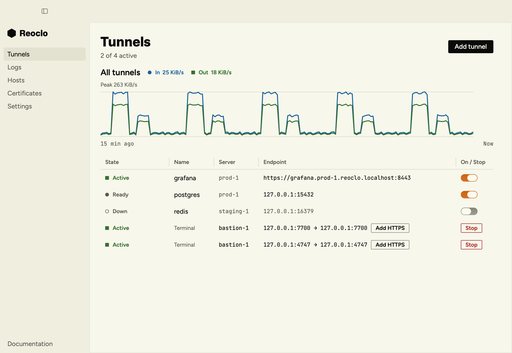

<p align="center">
  
</p>

# Reoclo for macOS

Reoclo for macOS puts your [Reoclo](https://reoclo.com) tunnels in the menu bar. Bring a saved tunnel up with one switch and open its endpoint. When a tunnel fails, the app says why and what to do next.

It is a native app written in Rust and drawn with [Rune](https://github.com/anomalyco/rune). It controls the tunnel daemon that the [Reoclo CLI](https://github.com/reoclo/cli) runs on your Mac, and it never stores your Reoclo credentials.

<picture>
  <source media="(prefers-color-scheme: dark)" srcset="docs/images/tunnels-dark.png">
  
</picture>

## What you can do

- **Reach a server's private services.** Forward a database or an internal dashboard to a port on your Mac, then connect with the tools you already use. Every saved tunnel has its own switch.
- **Open internal sites over HTTPS.** An HTTPS tunnel gets a trusted certificate and a hostname such as `https://grafana.prod-1.reoclo.localhost:8443`. Turn on the port 443 relay and the port drops out of the address.
- **Serve your own apps on HTTPS.** A local tunnel gives a service on your Mac a hostname under a domain you trust, such as `https://app.reoclo.test`.
- **Work from the menu bar.** The panel puts agent approvals and failed tunnels first, then gives every tunnel, saved or terminal, one line with its endpoint and switch. Press an endpoint to copy it. The menu bar item can show the active count, or a meter with one bar per tunnel.
- **Keep coding agents in check.** Agents using Reoclo's MCP tools can open forward tunnels on their own. Reverse tunnels, public binds, hostname changes and tailnet shares wait for your approval in the app.
- **See tunnels started in a terminal.** A `reoclo tunnel <server> -L ...` session appears in the main table. Each forward has its real ports and Add HTTPS. Stop asks before ending the terminal session.
- **Inspect traffic and recovery.** The top of Tunnels shows the last 15 minutes of traffic. Select a row for its details and traffic, or choose All tunnels for the combined graph. Scheduled retries show their attempt and next time, with Retry now.
- **Read daemon logs.** Logs combines live events with `tunneld.log`, using virtualized monospace rows and UTC timestamps. Pick a tunnel from a searchable list, or search the text. Pause freezes the view while collection continues. Copy exports the filtered lines, and Show log in Finder reveals the file.

## Requirements

You need macOS 13 or later and a [Reoclo](https://reoclo.com) account. You can create the account when you log in. Nothing else is required: the app carries its own copy of the Reoclo command, so you never need a terminal.

## Install

Download the disk image from [GitHub Releases](https://github.com/reoclo/desktop/releases/latest), open it, and drag Reoclo to Applications. The app supports Apple Silicon and Intel Macs. It is signed with a Developer ID and notarized by Apple, so it opens like any other Mac app.

If you use Homebrew, you can install the app and the command yourself:

```sh
brew install reoclo/tap/reoclo
brew install --cask reoclo/tap/reoclo-desktop
```

The app uses a Homebrew copy of `reoclo` when there is one and keeps it out of the way of its own. Keep it current with `brew upgrade reoclo`. To build from source, see [Development](docs/development.md).

## First run

The first time Reoclo opens, a short setup signs you in and prepares this Mac and your coding agents. Each step says what is about to happen before it happens, and you can finish the Mac setup later from Settings. [First run](docs/first-run.md) walks through it.

## Documentation

| Guide | What it covers |
|-------|----------------|
| [Using the app](docs/using-the-app.md) | Traffic and logs, the menu-bar panel, adding tunnels and local HTTPS |
| [First run](docs/first-run.md) | The setup steps, and what macOS asks for along the way |
| [How it works](docs/how-it-works.md) | The daemon and the CLI the app relies on, and how updates install |
| [Development](docs/development.md) | Building from source, demo mode, headless rendering and the checks |
| [Releasing](docs/releasing.md) | Packaging and notarizing, and the release workflow with its secrets |

## License

[Apache-2.0](LICENSE), with attributions in [NOTICE](NOTICE). The bundled fonts are under the SIL Open Font License 1.1, with their licenses in [assets/fonts](assets/fonts).
