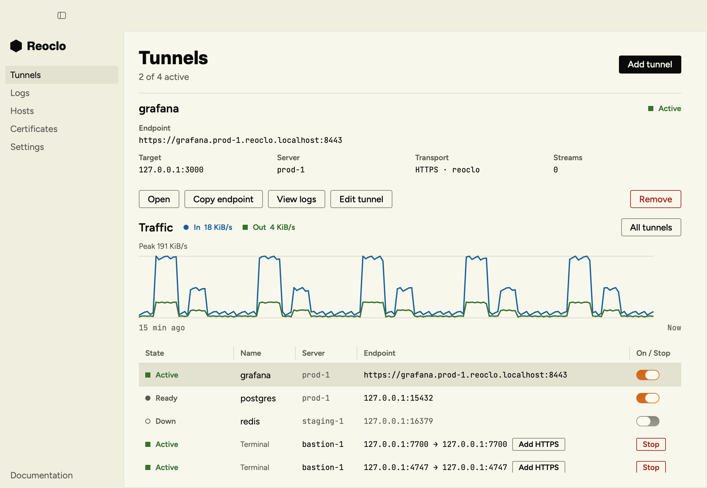
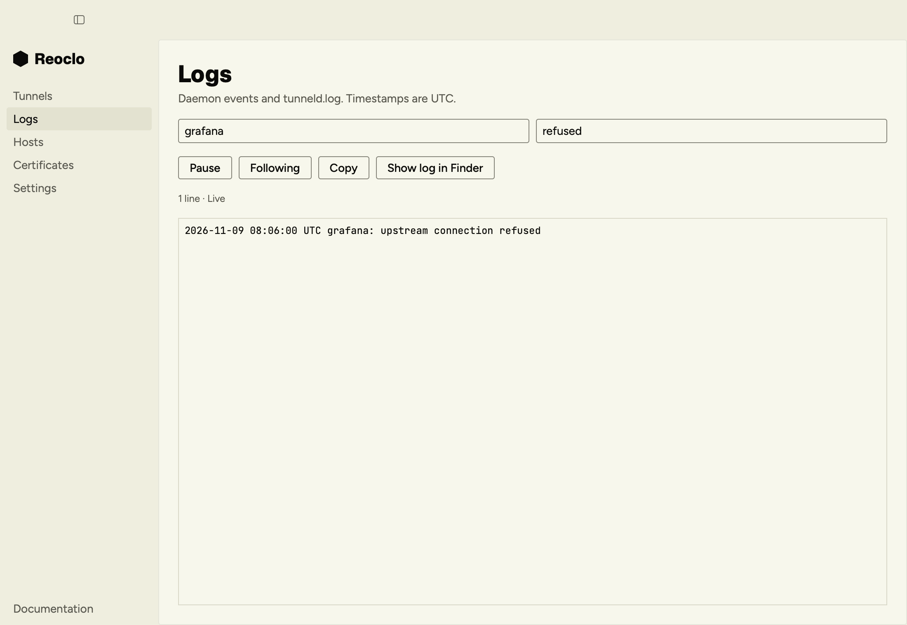
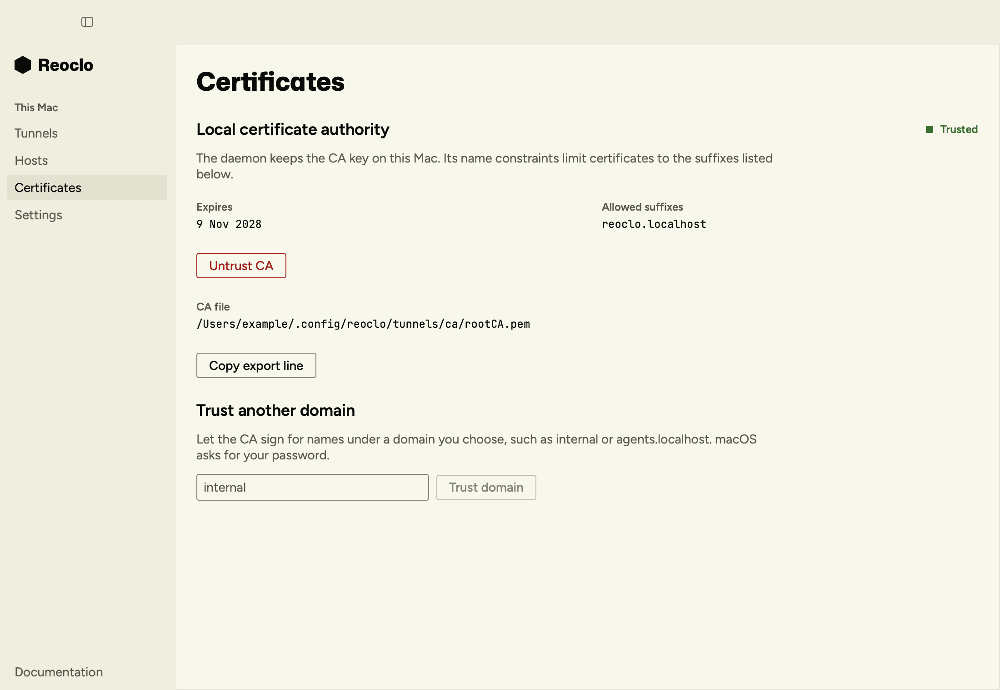
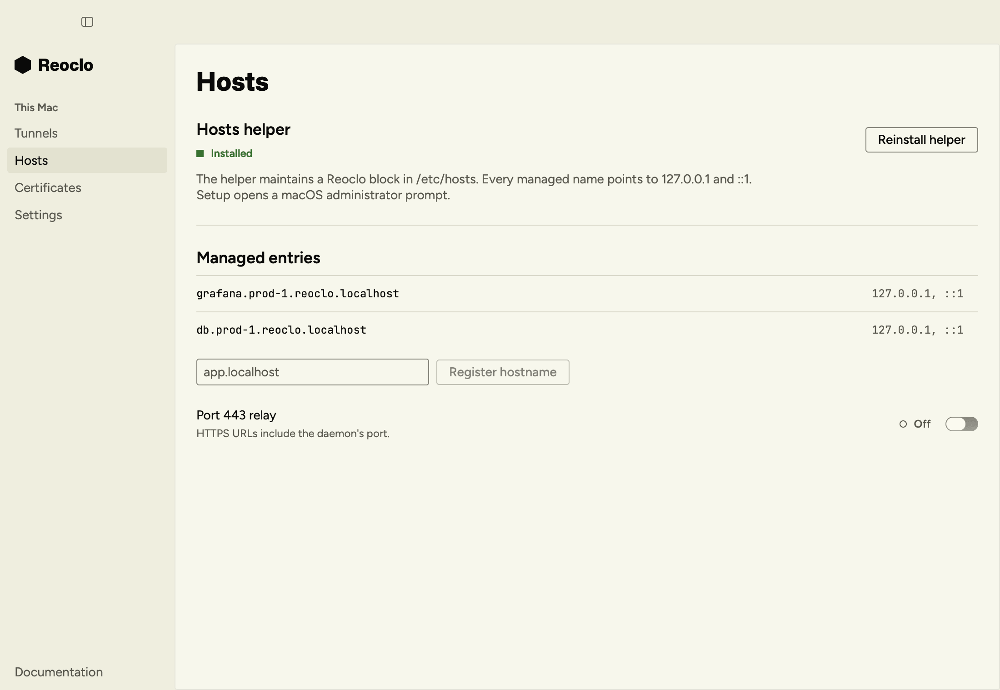
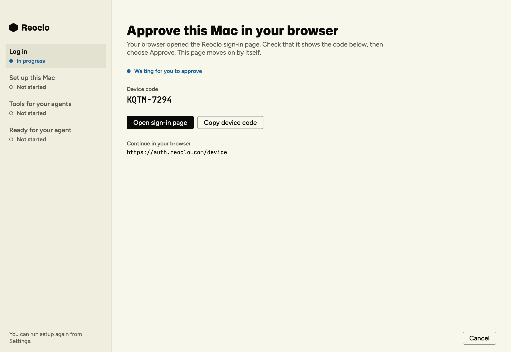
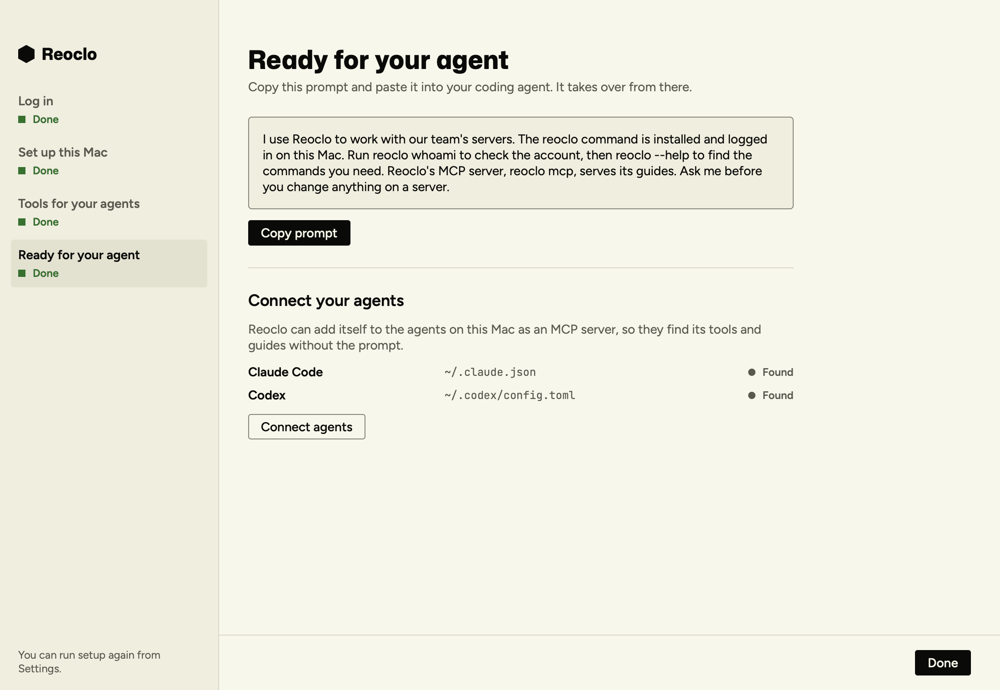
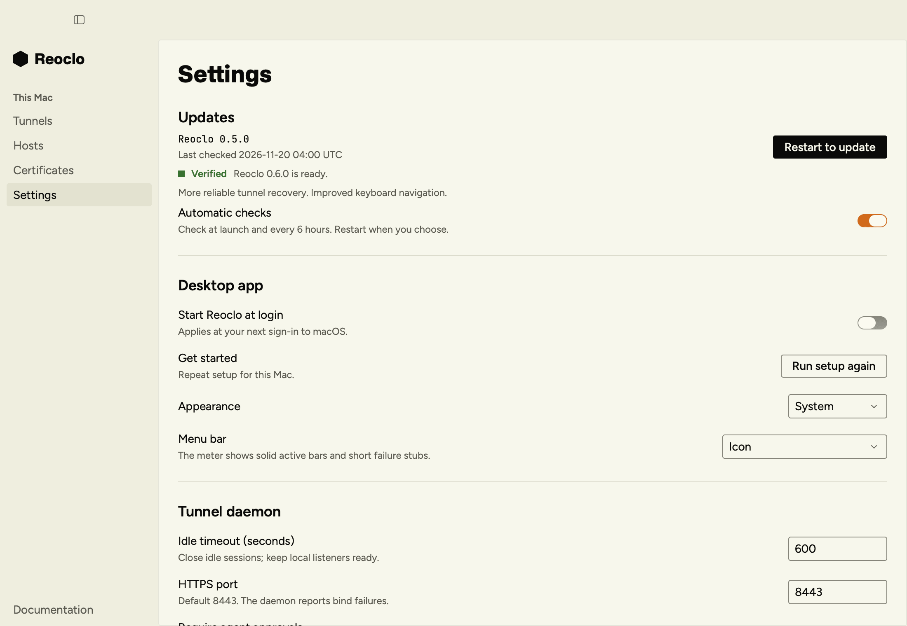

<p align="center">
  
</p>

# Reoclo for macOS

Reoclo for macOS puts your [Reoclo](https://reoclo.com) tunnels in the menu bar. Bring a saved tunnel up with one switch and open its endpoint. When a tunnel fails, the app says why and what to do next.

It is a native app written in Rust and drawn with [Rune](https://github.com/anomalyco/rune). It controls the tunnel daemon that the [Reoclo CLI](https://github.com/reoclo/cli) runs on your Mac, and it never stores your Reoclo credentials.

<picture>
  <source media="(prefers-color-scheme: dark)" srcset="docs/images/tunnels-dark.png">
  
</picture>

## What you can do

- **Reach a server's private services.** Forward a database or an internal dashboard to a port on your Mac, then connect with the tools you already use. Every saved tunnel has its own switch.
- **Open internal sites over HTTPS.** An HTTPS tunnel gets a trusted certificate and a hostname such as `https://grafana.prod-1.reoclo.localhost:8443`. Turn on the port 443 relay and the port drops out of the address.
- **Serve your own apps on HTTPS.** A local tunnel gives a service on your Mac a hostname under a domain you trust, such as `https://app.reoclo.test`.
- **Work from the menu bar.** The panel puts agent approvals and failed tunnels first, then gives every tunnel, saved or terminal, one line with its endpoint and switch. Press an endpoint to copy it. The menu bar item can show the active count, or a meter with one bar per tunnel.
- **Keep coding agents in check.** Agents using Reoclo's MCP tools can open forward tunnels on their own. Reverse tunnels, public binds, hostname changes and tailnet shares wait for your approval in the app.
- **See tunnels started in a terminal.** A `reoclo tunnel <server> -L ...` session appears in the main table. Each forward has its real ports and Add HTTPS. Stop asks before ending the terminal session.
- **Inspect traffic and recovery.** The top of Tunnels shows the last 15 minutes of traffic. Select a row for its details and traffic, or choose All tunnels for the combined graph. Scheduled retries show their attempt and next time, with Retry now.
- **Read daemon logs.** Logs combines live events with `tunneld.log`, using virtualized monospace rows and UTC timestamps. Pick a tunnel from a searchable list, or search the text. Pause freezes the view while collection continues. Copy exports the filtered lines, and Show log in Finder reveals the file.

### Traffic and logs

Traffic history stays in memory while the app runs. It uses one-second daemon events, keeps at most 900 samples per tunnel and handles counter resets without spikes. Terminal traffic requires a terminal session started with CLI 0.116.0 or later.

<picture>
  <source media="(prefers-color-scheme: dark)" srcset="docs/images/traffic-dark.png">
  
</picture>
<picture>
  <source media="(prefers-color-scheme: dark)" srcset="docs/images/logs-dark.png">
  
</picture>

Logs retains the latest 10,000 lines. The file tail reads at most 2 MiB at a time and follows rotation. Live events and their matching file entries appear once. The file is `tunneld.log` in the tunnel directory, alongside the `run` directory containing `tunneld.sock`.

### The menu-bar panel

<picture>
  <source media="(prefers-color-scheme: dark)" srcset="docs/images/panel-dark.png">
  
</picture>

The header shows how many tunnels are active and the combined traffic of the last 15 minutes. Approvals and a ready update sit above the tunnels, and a tunnel that failed moves to the top with its reason. Each tunnel takes one line: a state mark, its name, the endpoint, and its switch. A tunnel started in a terminal shows its server with a Terminal tag, and Stop in place of the switch. Twelve tunnels fit without scrolling.

### Adding a tunnel

Pick an organization and a server, then choose one of the ports Reoclo scanned on it or type a target. For HTTPS, the form previews the hostname before you save.

<picture>
  <source media="(prefers-color-scheme: dark)" srcset="docs/images/add-tunnel-dark.png">
  
</picture>

### Local HTTPS

Certificates manages the local certificate authority and the domains it may sign for. Hosts keeps the hostnames that point at your Mac.

Certificate trust accepts `.test`, `.localhost`, `.internal`, `.home.arpa`, `.example` and `.invalid`, including their subdomains. The field validates as you type, and CLI 0.116.0 enforces the same rule at the trust boundary. Public DNS domains and `.local` are rejected. Existing unsupported suffixes remain visible so you can remove them before trusting a replacement CA.

<picture>
  <source media="(prefers-color-scheme: dark)" srcset="docs/images/certificates-dark.png">
  
</picture>
<picture>
  <source media="(prefers-color-scheme: dark)" srcset="docs/images/hosts-dark.png">
  
</picture>

## Requirements

You need macOS 13 or later and a [Reoclo](https://reoclo.com) account. You can create the account when you log in. Nothing else is required: the app carries its own copy of the Reoclo command, so you never need a terminal.

## Install

Download the disk image from [GitHub Releases](https://github.com/reoclo/desktop/releases/latest), open it, and drag Reoclo to Applications. The app supports Apple Silicon and Intel Macs. It is signed with a Developer ID and notarized by Apple, so it opens like any other Mac app.

## First run

The first time Reoclo opens, a short setup walks you through everything. The steps are listed on the left, and each one tells you what is about to happen before it happens.

1. **Log in.** Reoclo starts its background service and opens your browser. Check that the page shows the code on screen, then choose Approve. If you opened a link from a teammate first, Reoclo keeps it and opens it when setup is done.
2. **Set up this Mac.** Reoclo trusts its own certificate so your servers' pages open without warnings, then installs a small helper so their addresses work like any website. macOS asks for your login password or Touch ID, and then for an administrator password. Reoclo never sees either one. You can choose **Set up later** and finish from Settings.
3. **Tools for your agents.** Reoclo puts its own `reoclo` command where coding agents look for it. If the command is already on your Mac, for example from Homebrew, Reoclo leaves it alone and uses it. Restart any agent that is already open so it finds the command.
4. **Ready for your agent.** Copy the prompt and paste it into Claude Code, Codex or Cursor. If Claude Code or Codex is on this Mac, **Connect your agents** adds Reoclo to them in one click and shows the result for each one.

<picture>
  <source media="(prefers-color-scheme: dark)" srcset="docs/images/first-run-dark.png">
  
</picture>

Press **Done** to finish. Settings has **Run setup again** if you want to see it once more.

<picture>
  <source media="(prefers-color-scheme: dark)" srcset="docs/images/first-run-ready-dark.png">
  
</picture>

## Other ways to install

If you use Homebrew, you can install the app and the command yourself:

```sh
brew install reoclo/tap/reoclo
brew install --cask reoclo/tap/reoclo-desktop
```

The app uses a Homebrew copy of `reoclo` when there is one and keeps it out of the way of its own. Keep it current with `brew upgrade reoclo`.

To build from source, install [rustup](https://rustup.rs) and [uv](https://docs.astral.sh/uv/). Rustup installs the pinned compiler on the first build; uv builds the disk image. Install the command with the Homebrew line above first.

```sh
git clone https://github.com/reoclo/desktop.git
cd desktop
scripts/bundle-macos.sh "$(command -v reoclo)"
cp -R dist/Reoclo.app /Applications/
open /Applications/Reoclo.app
```

The app is signed ad hoc, and `dist/Reoclo.dmg` holds the same app.

## How it works

The daemon holds the tunnels, your sign-in, the certificates and the privileged helpers. The app talks to it over its Unix socket with HTTP and server-sent events, so quitting the app leaves your tunnels running.

Actions that change the system, such as installing the background service or the hosts helper, run the Reoclo CLI already on your Mac. That way `brew upgrade reoclo` reaches the daemon. Unless `REOCLO_CLI` names one, the app uses the CLI the daemon reports, then the one in the daemon's launch agent, then the standard install folders, Homebrew's first. The copy bundled in the app runs only when none of those exists, and an installed CLI older than 0.103.1 gets an upgrade prompt. First run links the bundled copy at `~/.local/bin/reoclo` and adds one marked block to `~/.zshenv`, unless a working `reoclo` is already on your PATH. Connect your agents runs the bundled command's `reoclo mcp agents` and `reoclo mcp install`, registering the PATH link with each agent, or the bundled binary when another `reoclo` is in charge. The checks for an existing command wait at most five seconds for your login shell, then fall back to the usual install folders.

A `reoclo://open` link opens a service on a server after you confirm it. The app signs in if needed, reuses or adds the matching tunnel, then opens the HTTPS address or copies the local endpoint.

Start at login writes only the app's own launch agent and applies at the next macOS login.

## Updates

Reoclo checks GitHub Releases after launch and every 6 hours. It downloads newer versions in the background and verifies the archive's SHA-256 and Ed25519 signature against the key embedded in the app. Settings shows the last check and offers **Check now**. Turn off **Automatic checks** to check manually.

When an update is verified, choose **Restart to update** in Settings or **Restart** in the menu-bar panel. Reoclo never restarts on its own. It checks the extracted bundle version and stages the replacement on the app's volume. After the current process exits, it swaps the bundles and opens the new copy. If opening fails, it restores the previous app. Your tunnels keep running.

Updates are off outside an app bundle or when its folder is not writable, including a mounted disk image. Settings explains the reason. A failed download is discarded and reported there.

<picture>
  <source media="(prefers-color-scheme: dark)" srcset="docs/images/settings-dark.png">
  
</picture>

## Development

```sh
cargo run --bin reoclo-desktop -- --demo
```

Demo mode starts an in-process fake daemon under `.cache/run` and opens the normal window. It starts no real tunnel, installs no helper, leaves the keychain alone and registers no login item. Quit the app to remove the fake socket.

Rune and rune-kit are pinned to `78efd4a7876b5478dd72033ce6fd2b2f13ab9f9a`. Cargo does not inherit Rune's own `[patch.crates-io]` table, so [Cargo.toml](Cargo.toml) repeats it at the same rev. When you move the pin, copy the table from Rune's root `Cargo.toml` at the new rev. The compiler version is pinned in [rust-toolchain.toml](rust-toolchain.toml).

To keep that compiler out of your default toolchain, install it under `.cache`; the scripts pick it up from there:

```sh
export RUSTUP_HOME="$PWD/.cache/rustup"
export CARGO_HOME="$PWD/.cache/cargo"
```

### Headless rendering

The app can render any screen from fixture data, write a PNG and an element tree, and exit:

```sh
cargo run --bin reoclo-desktop -- \
  --fixture --screen tunnels --state loaded --theme dark \
  --snap snapshots/tunnels.png --tree snapshots/tunnels.json
```

Screens: `tunnels`, `logs`, `add`, `edit`, `hosts`, `certificates`, `settings`, `panel`.
Data states: `loaded`, `loading`, `empty`, `terminal`, `offline`, `signed-out`, `device-code`, `error`. First-run states, with `--screen first-run`: `welcome`, `welcome-failed`, `link`, `installing`, `waiting`, `pairing`, `pairing-failed`, `pairing-helper`, `tools`, `tools-homebrew`, `tools-failed`, `ready`, `ready-agents`, `ready-connected` and `loading`. Update fixtures: `update-available`, `update-ready`, `update-error`, `update-disabled`.
Tunnel-state fixtures accept the daemon's twelve state names, and `--reduced-motion` forces reduced motion.

Review fixtures include `traffic-all`, `traffic-selected`, `traffic-terminal` and `retrying` on Tunnels. `busy` adds ten saved tunnels and an approval to any screen, with one of those tunnels failed, while `quiet` and `failure` exercise the panel. Use `long` on Logs to exercise virtualization; its `filtered` and `paused` fixtures exercise the controls. Certificates supports `domain-valid` and `domain-invalid`. The snapshot script captures both themes at 1100 × 760 and 760 × 620. A 390 × 844 capture checks narrow content behavior.

For an explicit fake socket, run `cargo run --bin fake-daemon -- /path/to/socket`. It prints `READY` once bound; send `quit` on stdin to stop it. Then pass `--socket /path/to/socket` to the app.

A normal launch honors `--socket` and `REOCLO_CONTROL_SOCKET`, then follows the CLI's config resolution, starting with `REOCLO_CONFIG_DIR` and `XDG_CONFIG_HOME/reoclo`. The socket is `tunnels/run/tunneld.sock` under that directory.

### Checks

```sh
cargo fmt --check
cargo clippy --all-targets -- -D warnings
cargo test
bash scripts/snapshots.sh
bash scripts/readme-images.sh
```

The snapshot script renders every screen and data state in both themes, at the compact and wide window sizes, plus every tunnel state and frames from scrolling and motion. `snapshot-check` then verifies PNG signatures, viewport sizes, element roles and forbidden dash characters. It complements looking at the images rather than replacing it.

Tests use real Unix sockets and explicit subscriber signals with bounded timeouts. Rune interaction tests advance its virtual clock instead of sleeping.

After a UI change, `bash scripts/readme-images.sh` renders the screenshots in this README again.

### Packaging

`scripts/bundle-macos.sh /path/to/reoclo` builds `dist/Reoclo.app` with that CLI binary inside, signs both with the hardened runtime, verifies the signature and writes `dist/Reoclo.dmg`. Local builds are signed ad hoc. Set `REOCLO_SIGN_IDENTITY` to a Developer ID Application identity to sign with it and a secure timestamp, and the disk image is signed too; `REOCLO_SIGN_KEYCHAIN` names the keychain that holds it. `scripts/notarize-macos.sh` then submits the disk image to Apple's notary service with the App Store Connect API key file in `ASC_KEY_PATH` and its ids in `ASC_KEY_ID` and `ASC_ISSUER_ID`. It staples the ticket to the disk image and the app, and fails unless Gatekeeper accepts the app as notarized. Pass a prebuilt desktop binary as a second argument to package a universal build. The script neither installs nor launches the app, and it never fetches or substitutes a CLI. The disk image window is built with `dmgbuild` through `uvx`; its background comes from `assets/dmg/background.html`.

### Releases

The private Gitea repository mirrors branches and tags to `reoclo/desktop` on GitHub. Pushing a tag such as `v0.5.0` runs [.github/workflows/release.yml](.github/workflows/release.yml) on a macOS GitHub runner. The tag must match the Cargo package version. You can also dispatch the workflow with an existing tag.

The workflow builds both Mac architectures and combines them with `lipo`. It fetches the latest released CLI binaries and verifies their published checksums before making a universal CLI. The release notes record the CLI version. It imports the Developer ID Application certificate of BOXMARSHALL LTD (team `2446T6MBQU`) into a temporary keychain, signs the bundle with it and notarizes the disk image before packaging, so the download and the update archive both carry the stapled ticket. `scripts/package-release.sh` packages the signed app with permissions and symlinks intact and runs `update-sign` to write `latest.json`.

`MACOS_DEVELOPER_ID_P12` is a GitHub Actions secret holding that certificate and its private key as a base64 `.p12`, with its password in `MACOS_DEVELOPER_ID_P12_PASSWORD`. The App Store Connect API key used for notarization is `ASC_API_KEY_P8`, with its ids in `ASC_API_KEY_ID` and `ASC_API_ISSUER_ID`. A release fails rather than publish an unsigned build when they are missing.

`UPDATE_SIGNING_KEY` is a GitHub Actions secret containing the base64 raw 32-byte Ed25519 seed. The signer checks that it matches `assets/update-public-key.txt`. The app embeds only that public key. `update-sign --test-key` accepts a throwaway seed for local packaging exercises; it does not change the app's trusted key. For development, `REOCLO_UPDATE_URL` overrides the manifest endpoint. HTTPS is required except on loopback.

After building the local bundle, run `cargo build --bin update-sign` followed by `cargo run --example update-smoke`. This packages and signs the actual bundle with a generated test key, serves it over loopback, and uses `REOCLO_UPDATE_URL` in a child process to install it over a temporary older app. The test validates the installed bundle with `codesign` and never opens a live app. It prints `UPDATE INSTALL PASS` on success. `dist/latest.json` from this exercise is test-signed and must not be published.

Copy [packaging/homebrew/reoclo-desktop.rb](packaging/homebrew/reoclo-desktop.rb) to `Casks/reoclo-desktop.rb` in `reoclo/homebrew-tap`. Copy [packaging/homebrew/update-desktop-cask.yml](packaging/homebrew/update-desktop-cask.yml) to that repository's `.github/workflows/`. The tap's own token refreshes the cask every 30 minutes. Run it manually after the first release to replace the bootstrap `:no_check` checksum with the published DMG hash. No deploy key is needed.

## Code map

- `src/control*`: HTTP framing over the socket, typed errors, chunk decoding and server-sent events.
- `src/model.rs`, `src/reducer.rs`: tolerant wire types and pure event reduction.
- `src/connection.rs`: off-thread requests and the reconnecting event stream.
- `src/ui*`: native components, screen state, forms and replies.
- `src/theme.rs`, `assets/theme.json`, `assets/fonts/`: the Survey Sheet design tokens and fonts.
- `src/tray.rs`: the menu bar item and the click that opens the panel.
- `src/system*`, `src/cli.rs`: system actions such as the background service and administrator prompts, through the installed CLI.
- `src/fake*`, `fixtures/`: the fake daemon for development and tests.

The visual contract is in [DESIGN.md](DESIGN.md), and the product scope in [PRODUCT.md](PRODUCT.md).

## Status

Releases are signed with a Developer ID and notarized by Apple. GitHub Releases provides the downloads.

## License

[MIT](LICENSE). The bundled fonts are under the SIL Open Font License 1.1, with their licenses in [assets/fonts](assets/fonts).
