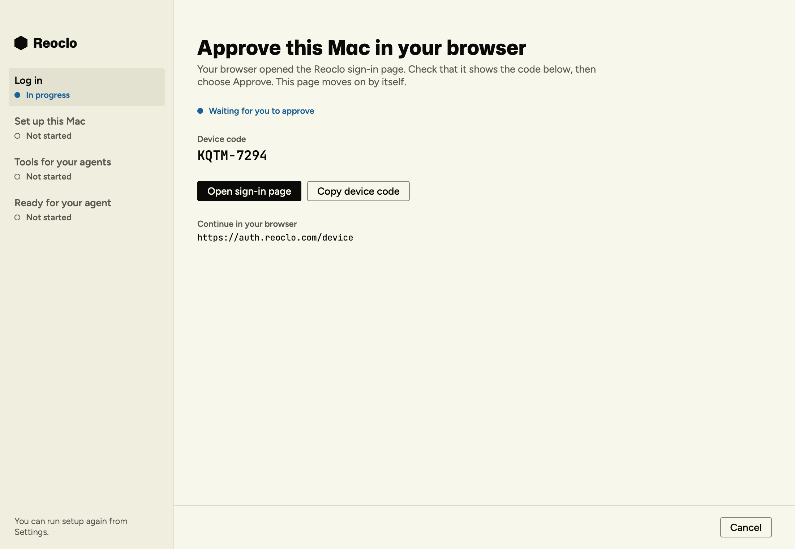
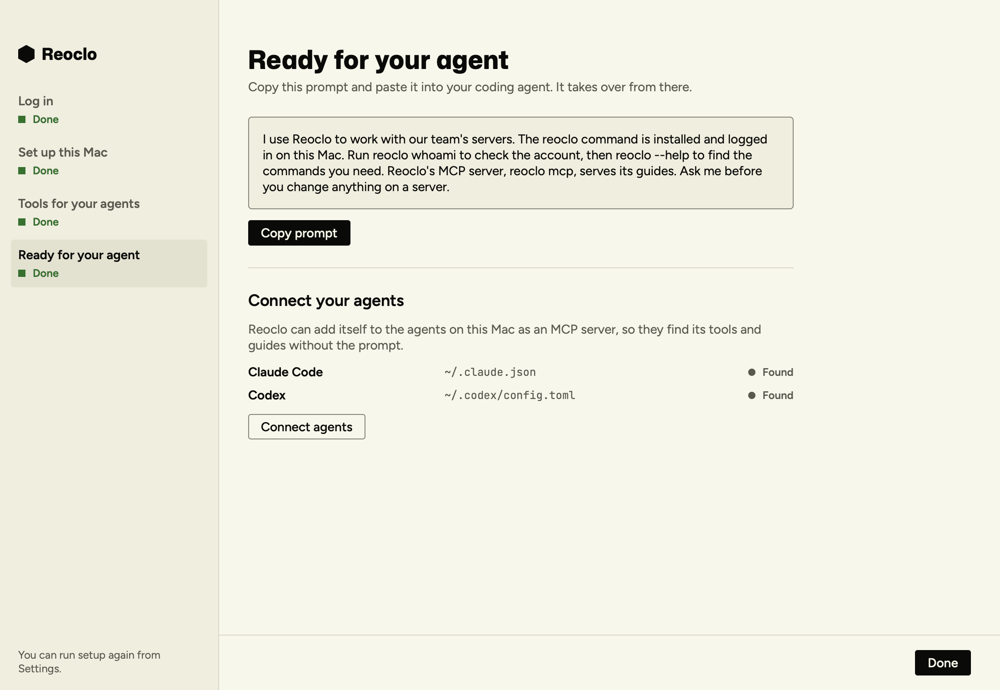

# First run

The first time Reoclo opens, a short setup walks you through everything. The steps are listed on the left, and each one tells you what is about to happen before it happens.

1. **Log in.** Reoclo starts its background service and opens your browser. Check that the page shows the code on screen, then choose Approve. If you opened a link from a teammate first, Reoclo keeps it and opens it when setup is done.
2. **Set up this Mac.** Reoclo trusts its own certificate so your servers' pages open without warnings, then installs a small helper so their addresses work like any website. macOS asks for your login password or Touch ID, and then for an administrator password. Reoclo never sees either one. You can choose **Set up later** and finish from Settings.
3. **Tools for your agents.** Reoclo puts its own `reoclo` command where coding agents look for it. If the command is already on your Mac, for example from Homebrew, Reoclo leaves it alone and uses it. Restart any agent that is already open so it finds the command.
4. **Ready for your agent.** Copy the prompt and paste it into Claude Code, Codex or Cursor. If Claude Code or Codex is on this Mac, **Connect your agents** adds Reoclo to them in one click and shows the result for each one.

<picture>
  <source media="(prefers-color-scheme: dark)" srcset="images/first-run-dark.png">
  
</picture>

Press **Done** to finish. Settings has **Run setup again** if you want to see it once more.

<picture>
  <source media="(prefers-color-scheme: dark)" srcset="images/first-run-ready-dark.png">
  
</picture>
