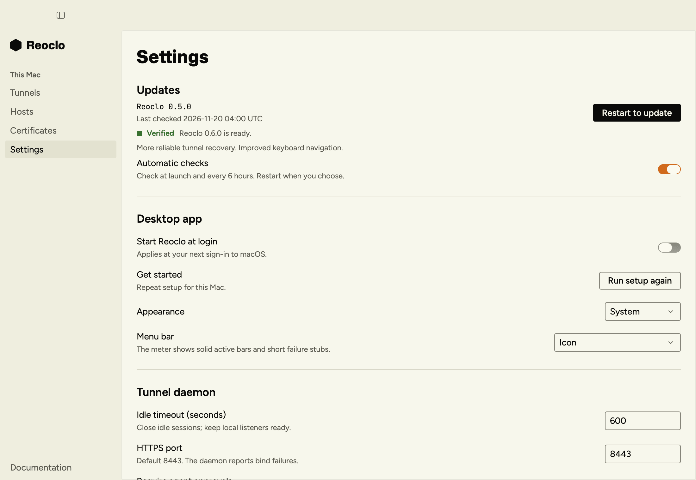

# How it works

The daemon holds the tunnels, your sign-in, the certificates and the privileged helpers. The app talks to it over its Unix socket with HTTP and server-sent events, so quitting the app leaves your tunnels running.

Actions that change the system, such as installing the background service or the hosts helper, run the Reoclo CLI already on your Mac. That way `brew upgrade reoclo` reaches the daemon. Unless `REOCLO_CLI` names one, the app uses the CLI the daemon reports, then the one in the daemon's launch agent, then the standard install folders, Homebrew's first. The copy bundled in the app runs only when none of those exists, and an installed CLI older than 0.103.1 gets an upgrade prompt. First run links the bundled copy at `~/.local/bin/reoclo` and adds one marked block to `~/.zshenv`, unless a working `reoclo` is already on your PATH. Connect your agents runs the bundled command's `reoclo mcp agents` and `reoclo mcp install`, registering the PATH link with each agent, or the bundled binary when another `reoclo` is in charge. The checks for an existing command wait at most five seconds for your login shell, then fall back to the usual install folders.

A `reoclo://open` link opens a service on a server after you confirm it. The app signs in if needed, reuses or adds the matching tunnel, then opens the HTTPS address or copies the local endpoint.

Start at login writes only the app's own launch agent and applies at the next macOS login.

## Updates

Reoclo checks GitHub Releases after launch and every 6 hours. It downloads newer versions in the background and verifies the archive's SHA-256 and Ed25519 signature against the key embedded in the app. Settings shows the last check and offers **Check now**. Turn off **Automatic checks** to check manually.

From 0.9.0 every release is signed with the Developer ID and notarized by Apple, and the update archive carries the same stapled app as the download. Installed copies from 0.5.0 on reach a notarized release through the updater, with no reinstall.

When an update is verified, choose **Restart to update** in Settings or **Restart** in the menu-bar panel. Reoclo never restarts on its own. It checks the extracted bundle version and stages the replacement on the app's volume. After the current process exits, it swaps the bundles and opens the new copy. If opening fails, it restores the previous app. Your tunnels keep running.

Updates are off outside an app bundle or when its folder is not writable, including a mounted disk image. Settings explains the reason. A failed download is discarded and reported there.

<picture>
  <source media="(prefers-color-scheme: dark)" srcset="images/settings-dark.png">
  
</picture>
