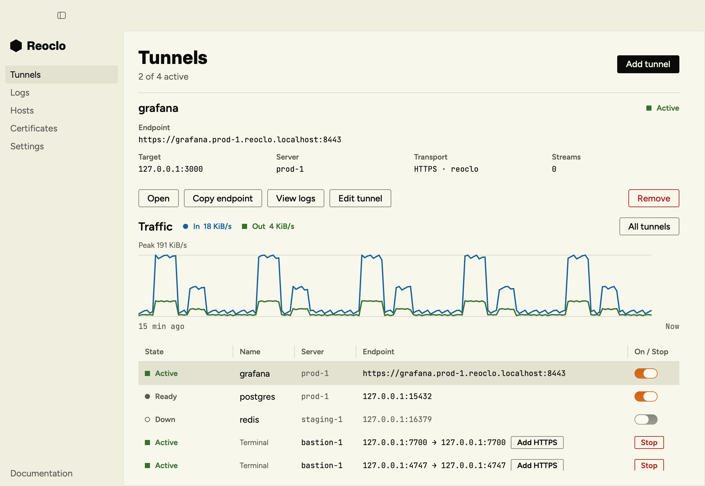
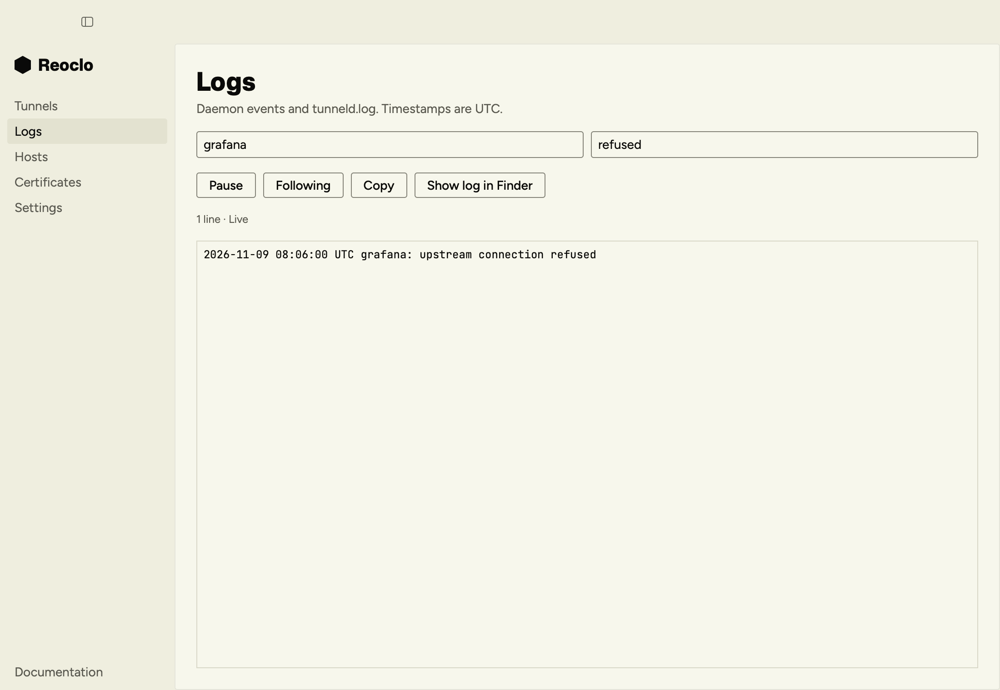
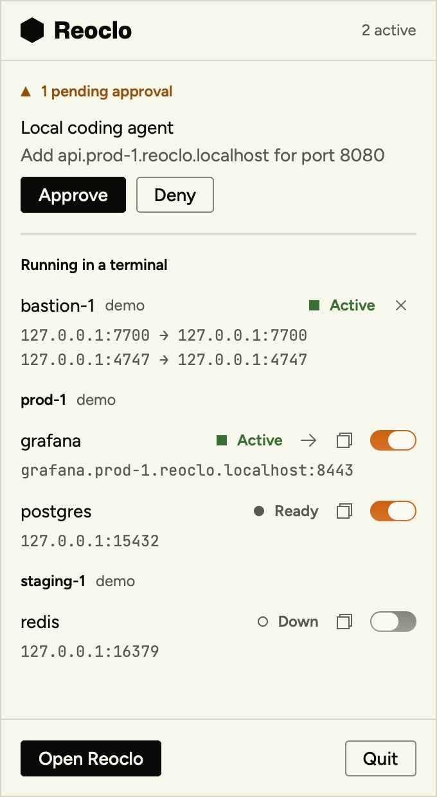
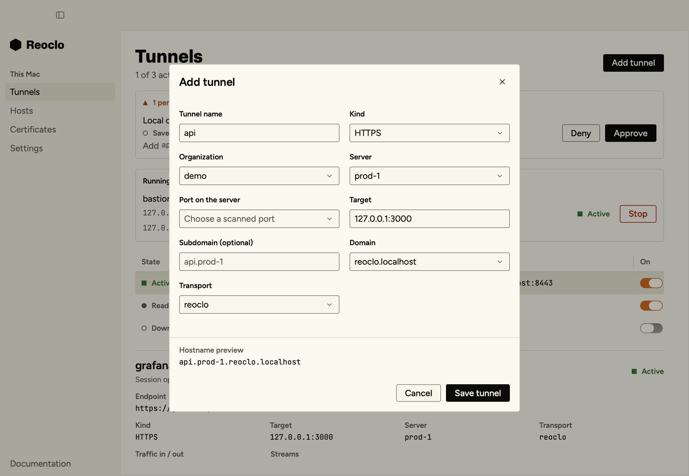
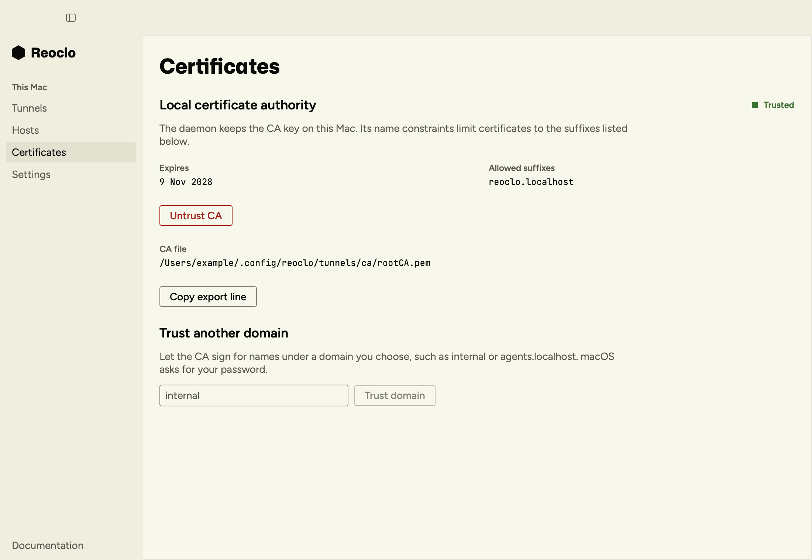
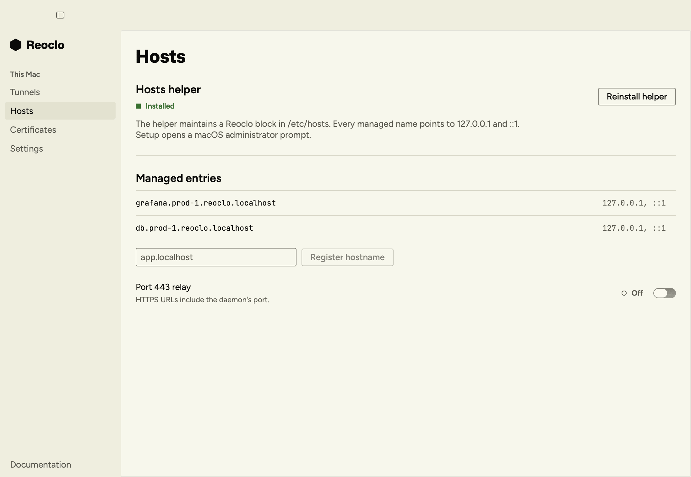

# Using the app

## Traffic and logs

Traffic history stays in memory while the app runs. It uses one-second daemon events, keeps at most 900 samples per tunnel and handles counter resets without spikes. Terminal traffic requires a terminal session started with CLI 0.116.0 or later.

<picture>
  <source media="(prefers-color-scheme: dark)" srcset="images/traffic-dark.png">
  
</picture>
<picture>
  <source media="(prefers-color-scheme: dark)" srcset="images/logs-dark.png">
  
</picture>

Logs retains the latest 10,000 lines. The file tail reads at most 2 MiB at a time and follows rotation. Live events and their matching file entries appear once. The file is `tunneld.log` in the tunnel directory, alongside the `run` directory containing `tunneld.sock`.

## The menu-bar panel

<picture>
  <source media="(prefers-color-scheme: dark)" srcset="images/panel-dark.png">
  
</picture>

The header shows how many tunnels are active and the combined traffic of the last 15 minutes. Approvals and a ready update sit above the tunnels, and a tunnel that failed moves to the top with its reason. Each tunnel takes one line: a state mark, its name, the endpoint, and its switch. A tunnel started in a terminal shows its server with a Terminal tag, and Stop in place of the switch. Twelve tunnels fit without scrolling.

## Adding a tunnel

Pick an organization and a server, then choose one of the ports Reoclo scanned on it or type a target. For HTTPS, the form previews the hostname before you save.

<picture>
  <source media="(prefers-color-scheme: dark)" srcset="images/add-tunnel-dark.png">
  
</picture>

## Local HTTPS

Certificates manages the local certificate authority and the domains it may sign for. Hosts keeps the hostnames that point at your Mac.

Certificate trust accepts `.test`, `.localhost`, `.internal`, `.home.arpa`, `.example` and `.invalid`, including their subdomains. The field validates as you type, and CLI 0.116.0 enforces the same rule at the trust boundary. Public DNS domains and `.local` are rejected. Existing unsupported suffixes remain visible so you can remove them before trusting a replacement CA.

<picture>
  <source media="(prefers-color-scheme: dark)" srcset="images/certificates-dark.png">
  
</picture>
<picture>
  <source media="(prefers-color-scheme: dark)" srcset="images/hosts-dark.png">
  
</picture>
